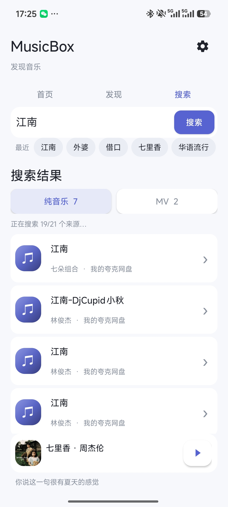
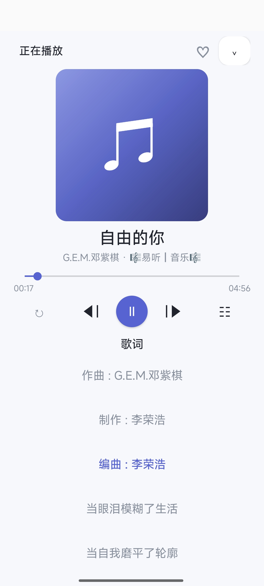

<div align="center">

# 🎵 MusicBox

**不依赖音乐平台会员，听见更多音乐。**

面向 Android 手机和平板的音乐播放器，基于 [TVBoxOS-Mobile](https://github.com/XiaoRanLiu3119/TVBoxOS-Mobile) 改造。

[](https://github.com/LuffyZhu/MusicBox/releases)
[](https://github.com/LuffyZhu/MusicBox/releases)
[](LICENSE)

[下载 APK](https://github.com/LuffyZhu/MusicBox/releases) · [使用方法](#开始使用) · [软件截图](#软件截图) · [构建项目](#自行构建)

</div>

## 为什么做 MusicBox

TVBox 的配置不只可以搜索视频，许多来源也能找到歌曲和 MV。MusicBox 把这部分能力放大：**先搜索自己的网盘音乐，再搜索自己配置的 TVBox 来源**，把原本需要打开网盘、翻找目录的听歌过程变成搜索和播放。播放器本身没有会员门槛；实际能听到哪些歌曲，取决于个人网盘、配置源和网络状态。

仓库提供的是播放器本身，**不预置 TVBox 订阅地址、站点清单或第三方爬虫 JAR**。你可以在应用里添加自己的配置源；可搜索到什么、能否播放，取决于所使用的来源和网络状态。

## 主要功能

| | 功能 | 说明 |
| --- | --- | --- |
| 🔎 | 聚合搜索 | 添加自己的 TVBox 配置源，搜索结果分为「纯音乐」和「MV」，保留搜索历史与输入提示。 |
| ☁️ | 个人网盘优先 | 登录自己的百度网盘或配置夸克网盘后，优先查找网盘里的音乐；播放时重新获取文件链接。 |
| 🎶 | 专注播放 | 迷你播放器、沉浸式播放页、进度调节、上一首／下一首、单曲循环和临时播放队列。 |
| 📝 | 歌词与封面 | 根据歌曲信息尝试匹配歌词与封面；有时间轴的歌词可跟随播放进度显示。匹配结果取决于文件名和外部服务。 |
| ♡ | 收藏与歌单 | 收藏歌曲、新建自己的歌单，将搜索结果加入歌单或设为下一首播放。 |
| ▶️ | 音乐视频 | 可搜索并播放 MV；另可使用 YouTube 音频和 MV，访问 YouTube 需要可用网络，必要时可在设置中配置代理。 |
| ⬆️ | 在线升级 | 在应用内检查版本，下载后校验文件大小和 SHA-256，再由 Android 系统确认安装。 |

## 软件截图

<div align="center">





搜索与分类 · 沉浸式播放 · MV

</div>

> 截图展示实际使用场景；搜索结果、封面和歌词会随配置源及网络状态变化。

## 开始使用

1. 从 [Releases](https://github.com/LuffyZhu/MusicBox/releases) 下载 APK，安装到 Android 手机或平板。
2. 打开右上角设置，进入 **「配置源」**，填入你自己的 TVBox 配置地址。
3. 如需搜索个人文件，在 **「个人网盘接入」** 中配置自己的百度或夸克网盘。
4. 搜索歌曲，在「纯音乐」和「MV」之间切换；点选曲目即可播放，也可以收藏或加入歌单。

YouTube 来源是可选功能；其可用性受所在网络、代理和上游服务影响。首次安装后若来源为空，请先检查配置源是否已加载。

## 下载与更新

安装包发布在 [GitHub Releases](https://github.com/LuffyZhu/MusicBox/releases)。应用内的 **「设置 → 在线升级」** 默认读取本仓库的 [`update.json`](update.json)；也可以改填其他公开的 HTTPS 更新清单地址。GitHub 下载在部分网络环境可能较慢。

覆盖安装需要保持相同包名与签名。当前测试版使用测试签名；在其他设备或构建环境重新签名的 APK 可能无法直接覆盖安装。

## 自行构建

需要 **JDK 17** 与 **Android SDK Platform 33**。在仓库根目录运行：

```powershell
./gradlew :app:assembleDebug
```

Windows 可使用 `gradlew.bat :app:assembleDebug`。把本机 SDK 路径写入未纳入仓库的 `local.properties`；APK 输出到 `app/build/outputs/apk/debug/`。维护者发布新版本可参考[发布步骤](docs/RELEASING.md)。

## 项目来源与许可

MusicBox 基于 [TVBoxOS-Mobile](https://github.com/XiaoRanLiu3119/TVBoxOS-Mobile) 改造，遵循 [AGPL-3.0](LICENSE)。第三方组件与来源见 [THIRD_PARTY_NOTICES.md](THIRD_PARTY_NOTICES.md)。外部配置和服务由用户自行选择；仓库不发布订阅地址、网盘凭据或站点 JAR。

欢迎通过 [Issues](https://github.com/LuffyZhu/MusicBox/issues) 反馈可复现的问题和使用建议。

## 赞赏 ☕

如果 MusicBox 对你有帮助，欢迎请作者喝杯咖啡。赞赏完全自愿，不影响任何功能的使用。

| 微信赞赏 | 支付宝赞赏 |
| :---: | :---: |
|  |  |
